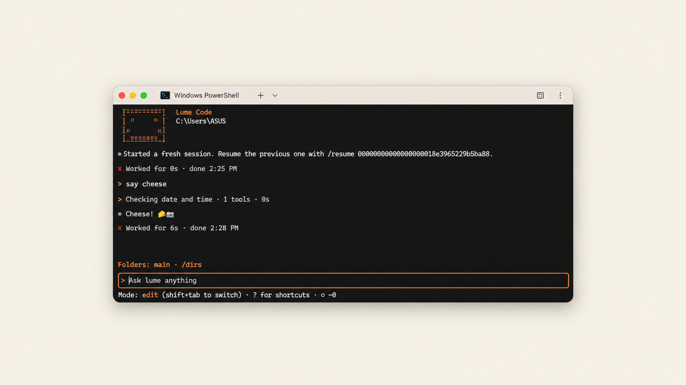

<p align="center">
  
</p>

# Lume Code

An AI coding agent that lives in your terminal. Built in Rust, powered by your Lume account.

Lume Code reads and edits files in your project, runs commands with your approval, plans before it changes anything, and picks up where you left off. It uses the same streaming replies, Guard, web tools, Deep Research and Coworker jobs as Lume.

## Features

- **Plan and Edit modes.** Shift-Tab switches between inspecting and planning, and making changes.
- **Approval first.** Shell commands and destructive file actions wait for your yes or no.
- **Project-scoped files.** Reads, searches and writes stay inside the project folder. Links, junctions, traversal and absolute paths are rejected.
- **Structural code search.** ASTRA uses ast-grep for syntax-aware search, with a plain text fallback.
- **Web and research.** Web tools, `/deep` research proposals and live `/research` progress.
- **Coworker jobs.** Upload files and run longer programs remotely with `/coworker`.
- **Sessions that survive.** Conversations are saved per account, backend and project. `/resume` restores one, and `/recovery` continues after an interruption.
- **Context management.** Automatic and manual `/compact`, plus `/btw` side questions that do not touch the main conversation.
- **Usage at a glance.** `/usage` and an automatic banner as you near your limit.
- **Streaming Markdown.** Headings, lists, code blocks and links render as the reply arrives.

## Install

Requires Windows x64 or macOS (Apple Silicon or Intel), and Node.js 20 or newer. Rust is not needed to install or use the npm package; Rust and Cargo are needed only to build or publish it.

```sh
npm install --global lume-code
lume
```

Supported platforms: Windows x64 and macOS (Apple Silicon and Intel). macOS support is new and still being tested.

## Quick start

```sh
lume login
lume
lume --project "/path/to/project"
```

Sign in through your browser with your normal Lume account. Your session is stored in the Windows Credential Manager or the macOS Keychain, and the client contains no model provider keys. Type `/` inside Lume for commands, or `?` for keyboard shortcuts.

## Safety

- Commands run on your PC with your user permissions, so read them before you approve.
- A command stops after 60 seconds, and its child processes are cleaned up.
- File writes are small, atomic and capped, and individual files are limited to 8 MiB.
- Passwords and email codes are only ever entered on the Lume website, never in the terminal.

## Configuration

Lume Code connects to the public Lume API at `https://api.lume.dpdns.org`. Set `LUME_CODE_API` to use another HTTPS backend, or a localhost HTTP address for development. No `.env` file from an untrusted project is loaded.

## Build from source

```sh
cargo build --release
cargo test
```

Run `target/release/lume-code login` on macOS, or `target\release\lume-code.exe login` on Windows. To build a self-contained npm package for the current host, run `npm pack` from `npm/`; `prepack` builds Lume Code and ASTRA automatically. Building requires Node.js 20+, Rust, and Cargo. The GitHub Actions workflow builds Windows and both macOS architectures for tagged releases; configure npm trusted publishing for the GitHub repository before creating a release tag.

## Documentation

- [Usage reference](docs/USAGE.md) covers every command, session behavior, limits and npm publishing.
- [npm package readme](npm/README.md) is what npm users see.

## License

Apache License 2.0, see [LICENSE](LICENSE). The npm package bundles [ast-grep](https://github.com/ast-grep/ast-grep), which remains under its own license.
